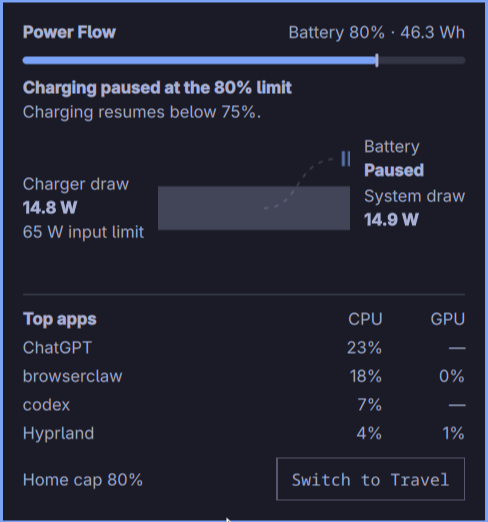
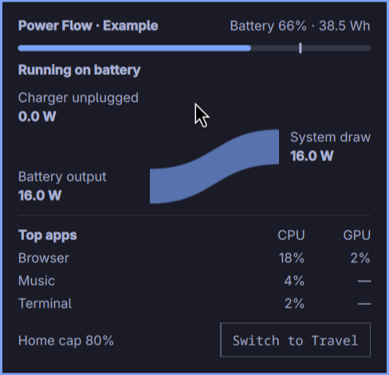
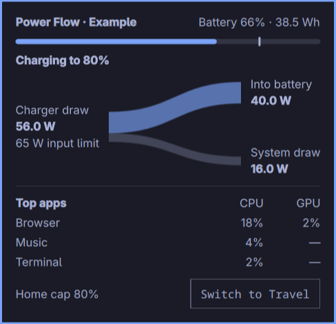
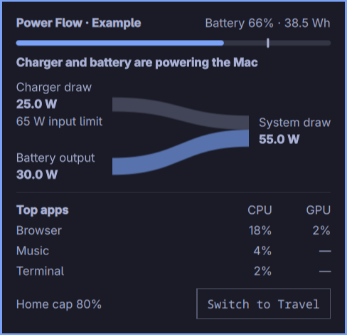

# Omarchy Power Flow

A battery charge control and power monitor for Apple Silicon Macs running
Arch Linux ARM and Omarchy's Quickshell bar.



These examples use simulated readings.

| Battery power | Battery charging | Charger and battery |
| --- | --- | --- |
|  |  |  |

## Install

Requires Omarchy with Quickshell, Python 3, polkit, TLP, and an Apple Silicon
kernel exposing macsmc-battery charge thresholds and macsmc_hwmon power
sensors. Charge-limit changes require an existing
`/etc/tlp.d/10-macbook-charge-limit.conf` with exactly one
`STOP_CHARGE_THRESH_BAT0=80` or `STOP_CHARGE_THRESH_BAT0=100` line.
TLP must be configured to manage the battery thresholds.

```sh
git clone https://github.com/muness/omarchy-power-flow.git
cd omarchy-power-flow
python3 install.py
```

The installer prompts graphically through polkit to install a root-owned,
fixed-purpose helper. It backs up the current user files under
`~/.local/state/dotfiles/battery-charge/`, extends the user menu and adds a
battery-care glyph beside the indicator group near the clock. It preserves
other widgets, menu entries and shell settings; rerunning updates the same control.
No Omarchy package files are patched. After updating the QML on a running desktop,
use `omarchy-restart-shell` to clear its component cache.

Click the battery-heart glyph to open **Power Flow**. The panel shows the
firmware's battery percentage, stored energy in Wh, the cap, and how much power flows between the
charger, system, and battery. Charger draw is the live reading. The input
limit shows the maximum reported by the connected charger. The panel
refreshes every two seconds while open. Power values are independent sensor
readings averaged over 0.4 seconds. Sampling, sensor characteristics and
power conversion can produce differences. Use
the button inside the panel to switch between **Home — 80%** and **Travel —
100%**. The button is disabled during the change. Cancelling the polkit prompt
leaves the current cap unchanged.

**System activity by app** samples while the panel is open and groups processes by
executable name. CPU is relative to one core, and GPU is relative to the
busiest engine used by each app. The dash marks unavailable GPU data.
The power diagram displays the machine's sensor readings in watts.

Set `"alwaysShow": true` on the layout entry to keep the icon visible. Otherwise,
the icon stays visible in Travel mode and appears in Home mode when you hover
the bar's empty center or indicator group.
The glyph refreshes immediately after the change, and polls every five seconds
for changes made elsewhere. Explicit Home/Travel choices remain searchable in
the Omarchy menu under **Battery charge limit**, with the active limit checked.

The helper updates `/etc/tlp.d/10-macbook-charge-limit.conf`, applies TLP and
checks the hardware threshold. Both choices persist across restarts. On an apply
failure it restores the previous configuration and attempts to restore the previous
runtime threshold. No reboot, service restart or forced discharge is needed.
Above 80%, the Home setting stops further charging; ordinary use lowers the charge.

Configure any other charge-limit service so TLP remains the sole manager
of the thresholds. Conflicting persistence rules can restore a different cap.

This deliberately keeps the standard battery widget: Omarchy reserves its clicks
for its power panel and battery-percentage toggle. The glyph inherits the
bar's fonts, colors and interaction styles.

To remove it, delete the `muness.battery-charge` entry from the shell's bar layout
and the marked battery block from the menu extension. Remove
`~/.config/omarchy/bar/modules/muness.battery-charge.qml` and
`~/.local/bin/battery-charge`, and use polkit to remove
`/usr/local/libexec/dotfiles-set-charge-limit`. The last selected TLP cap remains.

Verification: `python3 -m unittest discover -p 'test_*.py'`.

Licensed under the [MIT License](LICENSE).
